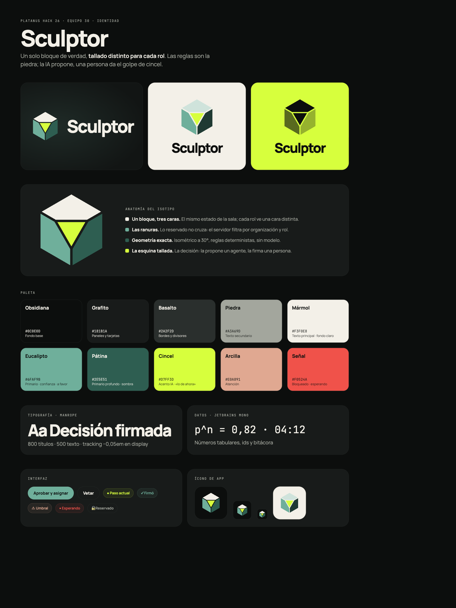

# Marca Sculptor

**Logo oficial: la galaxia NGC 253 en píxeles** (`project-logo.png`, `public/sculptor/logo.png`, `public/brand/galaxia/`). Es el concepto C de `conceptos-v2.png`, «NGC 253 en 1 bit»: la galaxia Sculptor real, de canto, hecha con píxeles; el núcleo lima es la decisión.

Cómo se llegó:

1. **v0, tres nombres** ([`proceso/conceptos-v0-nombres.png`](proceso/conceptos-v0-nombres.png)): Cupo, Velo y Quórum, cada uno con un signo que cuenta el producto.
2. **v2, cinco caminos para Sculptor** ([`conceptos-v2.png`](conceptos-v2.png)): piedra polimórfica, el corte, NGC 253 en 1 bit, frontera y el golpe.
3. **Primero el cubo** (piedra polimórfica, la propuesta que documenta el resto de este archivo y el manual) y después **la galaxia**, que quedó como logo oficial.

Lo que sigue es la propuesta del cubo, que se conserva como parte del proceso. La paleta (obsidiana, mármol, eucalipto, pátina y cincel lima) sí se usa en la landing `/sculptor`.

Manual completo (15 páginas): [`manual-de-marca-sculptor.pdf`](manual-de-marca-sculptor.pdf).

## Idea

Un solo bloque de verdad, tallado distinto para cada rol.

- **Un bloque, tres caras.** El mismo estado de la sala; cada rol ve una cara distinta (`projectStateForOrgAndRole`).
- **Las ranuras.** Lo reservado no cruza de una cara a otra: el servidor filtra por organización y rol.
- **Geometría exacta.** Isométrico a 30°: las reglas son código determinista, sin modelo.
- **La esquina tallada (lima).** La decisión: la propone un agente y la firma una persona.

## Archivos

| Archivo | Uso |
|---|---|
| `public/brand/sculptor-mark.svg` | Isotipo para fondo oscuro |
| `public/brand/sculptor-mark-light.svg` | Isotipo para fondo claro |
| `public/brand/sculptor-mark-mono.svg` | Isotipo a una tinta (`currentColor`) |
| `public/brand/sculptor-logo.svg` / `-light.svg` | Isotipo + nombre en horizontal (texto en Manrope) |
| `public/brand/sculptor-logo-1000.png` | 1000×1000, 67 KB: sirve como `project-logo.png` de la entrega |

## Paleta

| Nombre | Hex | Uso |
|---|---|---|
| Obsidiana | `#0C0E0D` | Fondo base |
| Grafito | `#181B1A` | Paneles y tarjetas |
| Basalto | `#2A2F2D` | Bordes y divisores |
| Piedra | `#A3A69D` | Texto secundario |
| Mármol | `#F3F0E8` | Texto principal, fondo claro |
| Eucalipto | `#6FAF9B` | Primario, a favor |
| Pátina | `#2E5E51` | Primario profundo, sombra |
| Cincel | `#D7FF3D` | Acento: paso actual. Usar poco |
| Arcilla | `#E0A891` | Atención |
| Señal | `#F0524A` | Bloqueado o esperando |

Eucalipto y arcilla vienen de la paleta actual; cincel es la lima del modo «night» llevada a un tono un poco más verde. Las reglas de color de `docs/DISENO.md` siguen valiendo: el color nunca va solo, siempre con icono y palabra.

## Tipografía

Manrope 800 para títulos (tracking −0,05em) y 500 para texto. JetBrains Mono para números y bitácora.
